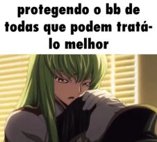

# Esdeath Bot

Bot de Discord que faz duas coisas: **coloca legenda em GIFs** no estilo meme (faixa branca com texto em cima) e **toca música na call** a partir do YouTube, Spotify, SoundCloud ou de arquivos enviados no chat.



## GIFs com legenda

- **`/legenda texto:<texto> gif:<arquivo>`**: envia o GIF junto com o comando.
- **`/legenda texto:<texto> link:<link>`**: aceita link do Tenor, do Giphy ou link direto de GIF/vídeo.
- **Clique direito numa mensagem → Apps → `Legendar GIF`**: abre uma caixa para digitar o texto. Funciona com os GIFs do seletor do próprio Discord.

Aceita GIF, MP4, WebM e imagens. O resultado é cortado em 15 segundos e comprimido até caber no limite de upload do servidor. Emojis na legenda também funcionam.

## Música

- **`/play busca:<link ou nome>`**: YouTube (vídeo ou playlist), SoundCloud, Spotify (música, álbum ou playlist pública), link direto de MP3/rádio ou só o nome da música.
- **`/tocar arquivo:<arquivo>`**: toca um áudio ou o som de um vídeo.
- **Clique direito numa mensagem → Apps → `Tocar na call`**: toca um arquivo que já foi enviado no chat.
- **`/pular`, `/pausar`, `/fila`, `/embaralhar`, `/parar`**.

Cada música vem com um painel de botões (⏸️ ⏭️ 🔀 📜 ⏹️), e só quem está na call consegue usar. O bot sai sozinho quando a fila acaba ou quando todo mundo sai da call.

O Spotify não deixa bots tocarem o áudio dele, então o bot lê os nomes das músicas e procura cada uma no YouTube. O YouTube e o SoundCloud são acessados pelo [yt-dlp](https://github.com/yt-dlp/yt-dlp), que o bot baixa e atualiza sozinho toda vez que liga.

## Rodando

1. Crie um app em <https://discord.com/developers/applications> e copie o token do bot e o Application ID.
2. Copie o `.env.example` para `.env` e preencha:
   ```
   DISCORD_TOKEN=seu_token
   CLIENT_ID=seu_application_id
   GUILD_ID=id_do_servidor   # opcional
   ```
3. Convide o bot com os escopos `bot` e `applications.commands` e as permissões Send Messages, Attach Files, Read Message History, View Channels, Connect e Speak.
4. Instale e ligue:
   ```bash
   npm install
   npm run deploy   # registra os slash commands
   npm start
   ```

### Hospedagem no Discloud

`npm run discloud` gera um `discloud.zip` pronto para subir no plano grátis do [Discloud](https://discloudbot.com). Como o plano grátis tem só 100 MB de RAM, lá o bot roda só com os GIFs (`MUSICA=desligada`).

## Estrutura

```
src/
  index.js              liga o bot e encaminha as interações
  deploy-commands.js    registra os comandos no Discord
  commands/             um arquivo por comando
  music/                fila, player, busca, Spotify e yt-dlp
  media/                download, faixa de texto e montagem do GIF com FFmpeg
assets/fonts/           Roboto Condensed e Noto Emoji (OFL)
scripts/discloud-zip.ps1
```

## Tecnologias

Node.js, discord.js v14, @discordjs/voice, FFmpeg, @napi-rs/canvas, sharp e yt-dlp.
